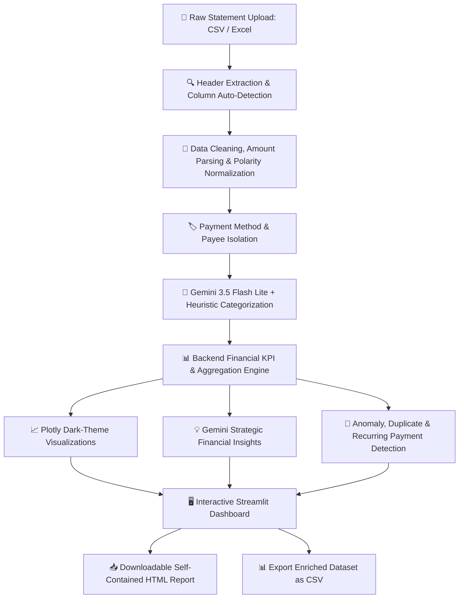

# 🏦 Bank Statement Analyzer & Financial Intelligence Dashboard

[](https://github.com/Aniket-Gund/Bank-Statement-Analyzer/stargazers)
[](https://python.org)
[](https://streamlit.io)
[](https://ai.google.dev)
[](https://plotly.com)
[](LICENSE)

An enterprise-grade, interactive financial analytics dashboard and bank statement parser built with **Python**, **Streamlit**, **Pandas**, **Plotly**, and **Google Gemini AI**. Ingests raw bank statements (CSV/Excel) across multiple banking formats, isolates counterparties, categorizes transactions via hybrid AI heuristics, computes rigorous financial KPIs, and generates executive-level insights and downloadable reports.

---

## 📸 Executive Previews

| Raw Statement Ingestion Format | Financial Analytics & Intelligence Dashboard |
|:---:|:---:|
|  |  |

---

## 🌟 Key Capabilities & Features

- **📂 Multi-Bank Auto-Detection & Adaptive Ingestion**:
  - Automatically identifies header rows, account holder names, statement periods, currencies, and branches across Indian and international banks (SBI, HDFC, ICICI, Bank of Baroda, Axis, etc.).
  - Supports both **single-amount statements with Dr/Cr indicators** and **dual-column statements with separate Withdrawal and Deposit amounts**.
  - Built-in interactive column mapping dropdowns for custom or non-standard file layouts.

- **🤖 Hybrid AI & Rule-Based Transaction Categorization**:
  - **Payment Method Isolation**: High-speed regex extraction for `UPI`, `Card Payment`, `NEFT / RTGS`, `IMPS`, `ATM Cash`, `Bank Charges`, `Salary`, and `Self Transfer`.
  - **Counterparty & Payee Extraction**: Cleans noise from complex Indian banking narrations (e.g. `UPI/Maharashtra xe/YESB/...` &rarr; `Maharashtra Xe`, `UPI/Mrs MANGAL DAT/...` &rarr; `Mangal Dat`, `UPI/slice/...` &rarr; `Slice`).
  - **AI Spending Categorization**: Powered by **Google Gemini 3.5 Flash Lite** with fallback to deterministic heuristic rules. Handles categories including *Groceries, Dining, Rent, Utilities, Transport, Shopping, Healthcare, Credit Card/Loans, and Personal Transfers*.

- **📊 Backend Financial KPI Engine**:
  - 💰 **Total Credits (Inflow)**: Aggregated total money deposited.
  - 💸 **Total Debits (Outflow)**: Aggregated total money spent.
  - ⚖️ **Net Cash Flow**: Real-time surplus / deficit calculation.
  - 🏦 **Opening & Closing Balance**: Accurate balance tracking with support for overdraft negative balances.
  - 📈 **Transaction Velocity**: Volume count and average debit ticket size.
  - ⚡ **Peak Single Outflow**: Automatically pinpoints the single largest expenditure.

- **📈 Interactive Dark-Theme Visualizations (Plotly & Chart.js)**:
  - 📈 **Daily Account Balance Trend**: Smooth area chart showing running daily liquidity.
  - 🍩 **Payment Method Distribution**: High-contrast donut breakdown.
  - 📊 **Spending by Category**: Ranked horizontal bar breakdown of expenditures.
  - 👥 **Top 10 Payees / Recipients**: Outflow concentration ranking.
  - ⚖️ **Weekly Cash Flow**: Grouped inflow vs outflow comparison.

- **🔍 Forensic Transaction Search & Advanced Filters**:
  - **Real-Time Free-Text Search**: Filter instantaneously by UPI Reference No., Transaction ID, Payee, Amount, or Narration.
  - **Automated Anomaly Detection**: Highlights high-value outliers (> 2 standard deviations).
  - **Recurring Payment Detection**: Flags frequent counterparties (subscriptions, rent, transit).
  - **Duplicate Detection**: Identifies potential duplicate charges on the same day.
  - **Transaction Inspector**: Modal inspection of full timestamps, balance impact, and raw banking narration.
  - **CSV Export**: One-click download of the enriched and categorized dataset.

- **💡 Gemini AI Strategic Insights & 15 RPM Safety**:
  - Generates personalized financial intelligence observations formatted with emoji badges and bold figures.
  - **Free-Tier 15 RPM Rate Limit Protection**: Detects 429 quota limits, presents a 60-second countdown with progress bar, and automatically retries upon renewal with zero application crashes.

- **📥 Self-Contained Offline HTML Report**:
  - Generates a standalone, single-file HTML report with embedded Chart.js visualizations, client-side real-time table search, responsive mobile CSS, and print-ready stylesheets.

---

## 🏗️ Architecture & Workflow



---

## 📂 Repository Structure

```
Bank-Statement-Analyzer/
│
├── sample_data/
│   ├── bank_statement_sample.xlsx   # Realistic multi-row statement matching user's bank
│   ├── bank_statement_sample.csv    # Pure CSV statement format
│   └── hdfc_format_sample.csv       # Dual-column format (separate Debit & Credit)
│
├── modules/
│   ├── __init__.py
│   ├── parser.py                    # Multi-bank file parser & metadata extractor
│   ├── categorizer.py               # Hybrid regex + Gemini AI merchant categorizer
│   ├── analyzer.py                  # Financial KPI engine & anomaly detection
│   ├── insights.py                  # Gemini AI strategic financial insights
│   └── report_generator.py          # Standalone Jinja2 + Chart.js HTML report builder
│
├── templates/
│   └── report.html                  # Responsive dark-theme HTML report template
│
├── app.py                           # Streamlit multi-tab web application
├── requirements.txt                 # Project Python dependencies
├── .env.example                     # Environment template (NO sensitive keys committed)
├── .gitignore                       # Production gitignore protecting secrets & cache
├── LICENSE                          # MIT License
└── README.md                        # Documentation
```

---

## 🛠️ Tech Stack

- **Frontend & App Framework**: [Streamlit](https://streamlit.io) (Dark Modern UI)
- **Data Engineering**: [Pandas](https://pandas.pydata.org), [NumPy](https://numpy.org), [openpyxl](https://openpyxl.readthedocs.io)
- **Interactive Visualizations**: [Plotly Express & Graph Objects](https://plotly.com), [Chart.js 4.4](https://www.chartjs.org)
- **Generative AI & LLM**: [Google Gemini 3.5 Flash Lite](https://ai.google.dev) via official `google-genai` SDK
- **Templating & Reporting**: [Jinja2](https://palletsprojects.com/p/jinja/), [MarkupSafe](https://palletsprojects.com/p/markupsafe/)
- **Configuration & Security**: [python-dotenv](https://github.com/theskumar/python-dotenv)

---

## 🚀 Getting Started

### 1. Clone the Repository

```bash
git clone https://github.com/Aniket-Gund/Bank-Statement-Analyzer.git
cd Bank-Statement-Analyzer
```

### 2. Set Up a Python Virtual Environment

```bash
# Windows
python -m venv venv
venv\Scripts\activate

# macOS / Linux
python3 -m venv venv
source venv/bin/activate
```

### 3. Install Dependencies

```bash
pip install -r requirements.txt
```

### 4. Configure Environment Variables

Create a `.env` file in the root directory by copying the provided template:

```bash
cp .env.example .env
```

Open `.env` and enter your Google Gemini API key:

```env
GEMINI_API_KEY=your_actual_gemini_api_key_here
```

> **Note**: You can obtain a free Gemini API key from [Google AI Studio](https://aistudio.google.com/).

### 5. Launch the Application

```bash
streamlit run app.py
```

The application will launch in your browser at `http://localhost:8501`.

---

## 🧪 Comprehensive Regression Testing

The system includes a 34-point regression suite covering extreme edge cases:
- Empty, whitespace, semicolon-delimited (`;`), and tab-delimited (`\t`) CSV files.
- 5-digit Excel serial dates (`45592`) and 12-hour timestamps with commas (`01/10/2026, 3:15 pm`).
- String amounts (`nan`, `inf`, accounting parentheses `(100.00)`, European decimal commas `1.234,50`).
- Reversals in withdrawal columns and polarity preservation in reverse-chronological statements.
- XSS neutralization and Chart.js script breakout immunity via Jinja2 autoescape and MarkupSafe serialization.

To run the verification test suite:
```bash
python scratch/test_fuzz_comprehensive.py
```

---

## 👨‍💻 Author

**Aniket Gund**
- GitHub: [@Aniket-Gund](https://github.com/Aniket-Gund)
- LinkedIn: [Aniket Gund](https://www.linkedin.com/in/aniket-gund/)

---

## 📄 License

Distributed under the [MIT License](LICENSE).
